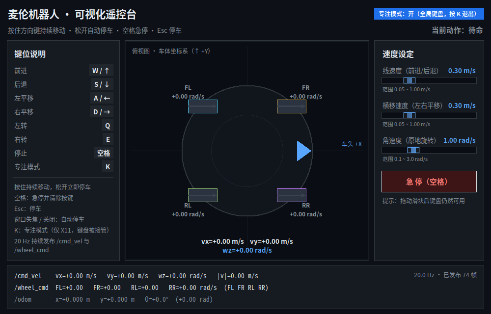

# robot_control —— 麦伦麦轮底盘运动控制与可视化测试

`robot_control` 是知融杯机器人「麦伦」的**麦轮底盘运动控制与联调测试**包，提供：

- 一份纯 Python 的麦轮运动学 / 键盘映射库（`mecanum.py`），与 URDF 几何参数严格一致；
- 一个 **Tkinter 中文可视化操作台**（`gui_teleop.py`，节点名 `mecanum_gui`）：
  俯视图实时显示四个麦轮的转向与转速，按键 / 滑块遥控，状态栏显示
  `/cmd_vel`、`/wheel_cmd` 与 `/odom`；
- 一个**终端键盘遥控**节点（`teleop_keyboard.py`，供没有图形界面的场合使用）；
- 一个**模拟底盘**节点（`sim_node.py`，节点名 `mecanum_sim`）：把四轮指令积分成
  轮关节状态、里程计与 TF，供 `robot_state_publisher` + RViz2 做可视化验证；
- 对应的 launch、RViz 配置与 pytest 测试。

> **重要说明（不要夸大）**：本包当前是「**模拟底盘 + 可视化测试**」链路，
> **还没有接入实车电机驱动**。`sim_node` 只是把 `/wheel_cmd` 积分成 `/odom` 与
> `/joint_states`，并不是真实底盘反馈。实车对接方式见下文
> [与实车驱动对接](#与实车驱动对接)。



> 截图为实机运行截图（按住 `W` 前进：四轮 +4.62 rad/s、`/cmd_vel` +0.30 m/s、
> 状态栏 `/odom` 同步更新）；本地运行 `ros2 launch robot_control teleop_gui.launch.py`
> 即可看到同样界面。

## 目录结构

```text
src/robot_control/
├── package.xml                         # ament 包描述
├── setup.py / setup.cfg                # entry_points：sim_node / teleop_keyboard / gui_teleop
├── resource/robot_control
├── robot_control/
│   ├── __init__.py
│   ├── mecanum.py                      # 公共运动学 + 键盘映射（不要改公式）
│   ├── sim_node.py                     # 模拟底盘：/wheel_cmd -> /joint_states + /odom + TF
│   ├── teleop_keyboard.py              # 终端键盘遥控
│   └── gui_teleop.py                   # Tkinter 可视化操作台（本包重点）
├── launch/
│   ├── teleop_gui.launch.py            # rsp + sim_node + GUI + RViz2（运动学仿真模式）
│   ├── teleop_keyboard.launch.py       # rsp + sim_node + 终端遥控 + RViz2
│   └── gazebo.launch.py                # Gazebo Classic 11 模式：gzserver + spawn + rsp + 可选遥控/RViz
├── worlds/test/gazebo_test.world       # 自带最小测试世界（zhirong_maps 缺失时回退用）
├── rviz/teleop.rviz                    # Fixed Frame=odom；Grid/RobotModel/TF/Odometry
├── test/
│   ├── test_mecanum.py                 # 运动学单测
│   ├── test_gui.py                     # TeleopPanel 界面逻辑单测（无显示自动 skip）
│   └── test_gazebo_launch.py           # Gazebo 插件/launch 参数离线单测（不启动 Gazebo）
├── docs/                               # 截图（由维护者放置 teleop_gui.png）
└── README.md
```

## 依赖

- ROS 2 **Humble**（rclpy、rclcpp 环境已 source）
- `geometry_msgs`、`std_msgs`、`nav_msgs`、`sensor_msgs`、`tf2_ros`
- `robot_state_publisher`、`robot_description`（URDF 包）、`rviz2`
- Python 3.10 + `tkinter`（Ubuntu：`sudo apt install python3-tk`）
- 测试：`pytest`
- **Gazebo 仿真（可选）**：Gazebo Classic 11 + `gazebo_ros` / `gazebo_plugins` 3.9
  （本开发机为用户态安装，运行前必须 `source tools/gazebo_env.sh`）；
  URDF 插件 `libgazebo_ros_planar_move.so`、`libgazebo_ros_joint_state_publisher.so` 由
  `gazebo_plugins` 提供，`spawn_entity.py` 由 `gazebo_ros` 提供。

## 构建与启动

```bash
# 1) 构建（在包含 src/ 的工作区根目录）
cd <workspace_root>
source /opt/ros/humble/setup.bash
colcon build --packages-select robot_description robot_control --symlink-install
source install/setup.bash

# 2) 可视化操作台（推荐；需要图形界面 + DISPLAY）
ros2 launch robot_control teleop_gui.launch.py

# 3) 无 RViz（节省资源 / RViz 无法创建 OpenGL 环境时）
ros2 launch robot_control teleop_gui.launch.py rviz:=false

# 4) 无图形界面（服务器、CI）：只启动 robot_state_publisher + sim_node
ros2 launch robot_control teleop_gui.launch.py gui:=false rviz:=false

# 5) 终端键盘模式（不需要 GUI，但需要终端可交互）
ros2 launch robot_control teleop_keyboard.launch.py rviz:=false

# 6) 单独运行 GUI（源码目录调试，不需要 colcon 安装本包）
cd src/robot_control
DISPLAY=:1 python3 -m robot_control.gui_teleop

# 7) Gazebo Classic 11 仿真（gzserver + 机器人 + /odom/TF；详见下文「Gazebo 仿真」）
source ../../../../tools/gazebo_env.sh   # 用户态 Gazebo 环境（机器相关路径）
unset DISPLAY                            # 本机 X :1 GLX 损坏时（headless）
ros2 launch robot_control gazebo.launch.py
```

`teleop_gui.launch.py` / `teleop_keyboard.launch.py` 支持的 launch 参数：

| 参数 | 默认值 | 说明 |
| --- | --- | --- |
| `rviz` | `true` | 是否启动 RViz2（加载 `rviz/teleop.rviz`） |
| `gui` | `true` | （仅 `teleop_gui`）是否启动 Tkinter 操作台；无 DISPLAY 时设 `false` |
| `focus_mode` | `true` | （仅 `teleop_gui`）启动后是否默认进入「专注模式」（X11 全局键盘；`false` 时需先聚焦窗口再按 `K` 开启） |
| `use_sim_time` | `false` | 是否使用 `/clock` 仿真时间（回放 / Gazebo 时设 `true`） |

URDF 定位：优先使用 `robot_description` 包中的 `urdf/omni_robot.urdf`；源码目录
启动时若 ament 索引中找不到该包，会回退到本包同级的 `../robot_description`
（部署后的 `src/robot/robot_description`），也支持用环境变量
`ROBOT_DESCRIPTION_ROOT=/path/to/robot_description` 显式指定。URDF 中的
`package://robot_description/...` 网格路径会被自动重写为 `file://` 百分号编码
URL，因此源码目录直接 `ros2 launch ./launch/teleop_gui.launch.py` 也能显示模型。

## 界面说明

| 区域 | 内容 |
| --- | --- |
| 顶部 | 标题、操作提示、「专注模式」徽标、「当前动作」实时显示 |
| 左侧 | 中文键位说明；按键生效时对应键帽高亮 |
| 中央 | 车体坐标系俯视图：车体圆 + 四轮位置；彩色指示条颜色区分 FL/FR/RL/RR，条内箭头方向表示正/反转、箭头长度表示转速大小；每个轮子旁显示实数 `rad/s`；绿色箭头表示车体平面速度矢量 |
| 右侧 | 线速度、横移速度、角速度三个滑块（实时数值 + 范围）、红色「急停」按钮 |
| 底部状态栏 | `/cmd_vel` 三维速度；`/wheel_cmd` 四轮 rad/s（FL FR RL RR）；`/odom` 位姿 `(x, y, θ)`；发布频率与已发布帧数 |

### 键位

| 动作 | 按键 | 说明 |
| --- | --- | --- |
| 前进 | `W` / `↑` | 按住持续前进 |
| 后退 | `S` / `↓` | 按住持续后退 |
| 左平移 | `A` / `←` | 按住持续向左横移 |
| 右平移 | `D` / `→` | 按住持续向右横移 |
| 原地左转 | `Q` | 逆时针 `+wz` |
| 原地右转 | `E` | 顺时针 `-wz` |
| 急停 | `空格` | 立即零速并清除所有按键 |
| 停车 | `Esc` | 停车（清除按键），节点继续运行 |
| 专注模式 | `K` | 切换 X11 全局键盘控制：进入后窗口/终端没有焦点也能遥控，再按 `K` 退出 |
| 关闭窗口 | 窗口 × | 发布零速后退出 |

操作要点：

- **按住持续移动、松开立即停车**。斜向组合（如 `W+A`）会自动归一化，
  合成平面速度不超过滑块设定值；
- X11 的键盘「自动重复」会产生大量 `Release`/`Press` 抖动，界面用 **60 ms
  防抖宽限**处理：松开后 60 ms 内若再次收到按下事件则视为仍在按住，保证不会
  误停车；真正松开 60 ms 后发布零速；
- **按键静默兜底**：若 X 服务器在 `KeyRelease` 之后又补送一个迟到的自动重复
  `KeyPress`（XTest 注入、远程/虚拟键盘、丢失 release 时偶发），60 ms 防抖会把
  该方向误判为“仍按住”。`key_silence_timeout`（默认 1.2 s）在“还有按键状态、
  但超过该时间没有收到任何按键事件”时强制清空按键并发布零速（无论窗口是否
  有焦点），保证方向指令最多 1.2 s 后自动回零、不会永久粘滞；正常按住时 X11
  自动重复会持续刷新，不会误停。设为 `<=0` 可关闭该兜底（不推荐）；
- **窗口失焦 / 关闭窗口 / Ctrl-C** 都会立即发布零速；`cmd_timeout`（默认 0.5 s）
  作为安全兜底：窗口失焦、或超时内既没有按键事件且窗口不持有键盘焦点时会自动
  停车（正常按住时 X11 键盘自动重复会持续刷新按键事件，不会误停）；
- **专注模式（K）**：进入后通过 X11 全局键盘抓取接管整个键盘，**窗口/终端失去
  焦点也能用 WASD/方向键遥控**（见下文[专注模式（K）](#专注模式k)）。专注模式
  下键盘被本程序独占，请务必记住 `K` 退出、`空格` 急停；
- 拖动滑块后键盘仍然可用（键盘事件绑定在 `bind_all` 上）；滑块修改速度后会
  立即用新速度重新发布当前指令。

## 专注模式（K，默认开启）

GUI 启动后**默认自动进入专注模式**（ROS 参数 `focus_mode_default=true`，launch
参数 `focus_mode` 默认 `true`）：启动约 250 ms 后程序通过 X11 `XGrabKeyboard`
主动接管整个键盘，**不需要先点窗口**——无论当前焦点在哪个窗口（浏览器、终端、
桌面……），WASD/方向键都能遥控机器人；按 `K` 退出并恢复键盘，再按 `K` 可手动
重新进入。


默认行为 / 进出方式：

1. 启动 GUI（`ros2 launch robot_control teleop_gui.launch.py`），窗口出现后自动
   进入专注模式（启动日志会提示「默认进入专注模式」）；
2. 顶部徽标变为蓝色 **「专注模式：开（全局键盘，按 K 退出）」**，此时不用点窗口，
   直接切换到其它窗口按 `W` 仍会输出 `/cmd_vel`、`/wheel_cmd`；
3. 按 `K`（任何时候、任何焦点下都有效）退出，徽标回到
   **「专注模式：关（按 K 开启）」**，并立即发布零速；退出后**不会**自动重新进入
   （自动开启只在启动时尝试一次），需要时再按 `K` 手动进入；
4. 若启动时抓取失败（无 DISPLAY / 键盘已被其它程序独占等），程序正常运行，
   徽标显示「专注模式：关（<中文原因>）」，点一下窗口后按 `K` 可重试。

关闭“默认开启”的方法（启动后仍需先聚焦 GUI 窗口、再按 `K` 进入专注模式）：

```bash
# launch 方式（推荐）
ros2 launch robot_control teleop_gui.launch.py focus_mode:=false

# 或者单独运行 GUI 节点时直接覆盖 ROS 参数
ros2 run robot_control gui_teleop --ros-args -p focus_mode_default:=false

# 源码目录调试
DISPLAY=:1 python3 -m robot_control.gui_teleop --ros-args -p focus_mode_default:=false
```

实现方式：`focus_grab.X11KeyboardGrab` 在后台读线程接收全局按键 -> 线程安全
队列 -> `FocusModeController` 用 `root.after(30)` 在 Tk 主线程分发；`K` 走
切换逻辑而不是运动映射。关闭窗口 / `Ctrl-C` / 失焦保护都会先释放键盘抓取再退出。

**长按（前进/后退/平移）**：专注模式下不再依赖系统键盘“自动重复”事件，而是
每 30 ms 用 `XQueryKeymap` 查询 X 服务器的物理键盘位图，按真实按键状态同步
运动指令：**物理按住就一直走，物理松开立即停**（即使系统关闭了键盘重复或
自动重复事件丢失也照样能长按）。

安全提示（重要）：

- 由于**默认开启**，GUI 一启动就会接管键盘：启动前请确认机器人处于安全测试
  状态（架起底盘 / 低速 / 空旷场地），并记住 `K` 退出、`空格` 急停；在共享
  桌面上测试时请用完立即关闭 GUI（关闭窗口会自动释放键盘）；
- 专注模式**期间键盘被本程序独占**，其它程序（浏览器、终端、IDE）都收不到
  键盘输入；这是“专注模式”的本意，但也意味着**必须先记住 `K` 退出**；
- 进入前请确认机器人处于安全测试状态（架起底盘 / 低速 / 空旷场地），`空格`
  始终是急停；
- 不要同时打开两个 GUI 并都进入专注模式：第二个会因键盘已被独占而启动失败，
  界面会显示中文原因；
- 关闭窗口、`Ctrl-C`、ROS 关闭都会自动释放抓取；如果进程被 `kill -9`，X 服务器
  会随进程消失自动释放抓取。

环境限制与排查：

- **仅支持 X11**（Xorg，或 XWayland 下的 X11 窗口）。纯 Wayland 会话里全局抓取
  **不完整/不可用**，请改用 Xorg 会话或窗口内遥控（保持焦点在 GUI 上）；
- **无 DISPLAY**（SSH 未开 X11 转发、无图形会话）时无法使用，按 `K` 会在徽标显示
  “没有 DISPLAY …”；
- 抓取失败（例如键盘已被其它程序独占 `AlreadyGrabbed`、抓取窗口不可见
  `NotViewable`）时不会崩溃：徽标会显示中文原因并保持关闭，可关闭占用键盘的
  程序/另一个专注模式实例后重试；
- 专注模式下 Tk 本身收不到键盘事件（按键全部由抓取线程处理），这是正常现象；
  按 `K` 退出后恢复窗口内按键。

## 话题

| 话题 | 类型 | 方向（相对本包） | 说明 |
| --- | --- | --- | --- |
| `/cmd_vel` | `geometry_msgs/msg/Twist` | `gui_teleop` / `teleop_keyboard` → 外部 | 车体速度指令；`linear.x` 前向、`linear.y` 左向、`angular.z` 逆时针（发布已按轮速限幅折算的实际可达速度） |
| `/wheel_cmd` | `std_msgs/msg/Float64MultiArray` | `gui_teleop` / `teleop_keyboard` → `sim_node` / 驱动 | 四轮角速度 `[rad/s]`，顺序 **FL, FR, RL, RR**；`layout.dim[0].label = "wheel_fl, wheel_fr, wheel_rl, wheel_rr"` |
| `/joint_states` | `sensor_msgs/msg/JointState` | `sim_node` → `robot_state_publisher` | 四个轮关节 `position`(rad)、`velocity`(rad/s) |
| `/odom` | `nav_msgs/msg/Odometry` | `sim_node` → RViz / 外部 | `frame_id=odom`、`child_frame_id=base_footprint`，含 pose/twist |
| TF `odom → base_footprint` | `tf2` | `sim_node` → RViz | 模拟底盘积分位姿；`base_footprint → base_link` 等由 `robot_state_publisher` 发布 |

## 节点参数

`gui_teleop`（节点名 `mecanum_gui`）与 `teleop_keyboard` 的公共参数：

| 参数 | 默认值 | 说明 |
| --- | --- | --- |
| `cmd_vel_topic` | `/cmd_vel` | 车体速度话题名 |
| `wheel_cmd_topic` | `/wheel_cmd` | 四轮指令话题名 |
| `linear_speed` | `0.30` | 前进/后退速度 m/s（GUI 滑块范围 0.05~1.0） |
| `lateral_speed` | `0.30` | 左/右横移速度 m/s（GUI 滑块范围 0.05~1.0） |
| `angular_speed` | `1.00` | 原地旋转角速度 rad/s（GUI 滑块范围 0.1~3.0） |
| `max_wheel_speed` | `30.0` | 轮速限幅 rad/s（四轮按比例统一限幅，保持方向） |
| `publish_rate` | `20.0` | `/cmd_vel` 与 `/wheel_cmd` 发布频率 Hz |

只有 `gui_teleop` 额外支持：

| 参数 | 默认值 | 说明 |
| --- | --- | --- |
| `window_title` | `麦伦机器人 · 麦轮遥控操作台` | 窗口标题（中文） |
| `cmd_timeout` | `0.5` | 失焦 / 无按键事件多久后自动停车 s（窗口仍持有键盘焦点时不误停；0 表示关闭） |
| `key_silence_timeout` | `1.2` | 按键静默兜底 s：有按键状态但超过该时间没有任何按键事件时清空按键并回零（无论焦点），防止迟到 KeyPress/丢失 release 造成指令粘滞；`<=0` 关闭 |
| `odom_topic` | `/odom` | 订阅的里程计话题，用于状态栏位姿显示 |

运行时覆盖参数示例：

```bash
ros2 run robot_control gui_teleop --ros-args -p linear_speed:=0.5 -p publish_rate:=20.0
ros2 launch robot_control teleop_gui.launch.py rviz:=false
```

`sim_node`（节点名 `mecanum_sim`）参数见 `robot_control/sim_node.py` 与
`robot_control_ws/INTERFACE.md`（`wheel_radius=0.065`、`wheel_base_x/y=0.170`、
`publish_rate=50`、`cmd_timeout=0.5`、`command_accel_limit=60` 等）。

## 运动学约定

四轮顺序固定 **FL, FR, RL, RR**，几何参数与 URDF 完全一致：
轮半径 `r=0.065 m`，轮心偏移 `bx=by=0.170 m`（旋转力臂 `bx+by=0.340 m`）。
URDF 中四轮 `axis="0 1 0"`，**正轮速 = 轮子向车头方向滚动**。

逆运动学（车体速度 → 轮速）：

```text
w_FL = (vx - vy - (bx+by)·wz) / r
w_FR = (vx + vy + (bx+by)·wz) / r
w_RL = (vx + vy - (bx+by)·wz) / r
w_RR = (vx - vy + (bx+by)·wz) / r
```

轮速上限统一用 `MecanumKinematics.body_to_limited_wheels()` 按比例限幅，
不会因为单轮裁剪而改变运动方向。公式只实现在 `robot_control/mecanum.py`，
GUI 与终端遥控都调用同一套 API。

## 模拟链路如何工作

```text
GUI/终端键盘 ──/cmd_vel────►（自动驾驶 / 外部订阅者）
             └/wheel_cmd───► sim_node ──/joint_states──► robot_state_publisher ──TF──► RViz2
                                   ├──/odom──────────────► RViz2（Odometry 迹线）
                                   └──TF odom→base_footprint
```

- `sim_node` 收到 `/wheel_cmd` 后做加速度斜坡（`command_accel_limit`），积分轮角、
  计算车体速度并积分里程计；
- `robot_state_publisher` 用参数 `robot_description`（launch 注入 URDF）发布
  轮子 TF，RViz 的 RobotModel 通过 `/robot_description` 话题获取模型；
- `rviz/teleop.rviz`：Fixed Frame=`odom`，含 Grid、RobotModel、TF、
  Odometry（`/odom`，Keep 200，显示 Axes + Covariance）。

## 一键启动入口（bring_up 包）

比赛现场/日常联调建议直接用工作空间里的 **`bring_up`** 包一条命令启动（它封装了本包的
`gazebo.launch.py`，并统一了场景、机器人、TF、可选遥控/RViz 的入口）：

```bash
ros2 launch bring_up bring_up.launch.py        # headless（默认）
ros2 launch bring_up demo.launch.py            # 有显示器：gzclient + RViz + GUI 遥控
```

参数与本文档的 `gazebo.launch.py` 完全一致（`world/x/y/z/yaw/gui/rviz/teleop/...` 透传）。

## Gazebo 仿真（Gazebo Classic 11）

除了上文的 `sim_node` 运动学仿真，本包还支持 **Gazebo 物理仿真**模式：机器人由
Gazebo 承载，`/cmd_vel` 由 URDF 里的 Gazebo 插件驱动车体并发布 `/odom` 与 TF，
`/joint_states` 由插件发布，`robot_state_publisher` 只负责 URDF→TF 树。

### 两种模式对比

| | `sim_node` 模式（teleop_*.launch.py） | Gazebo 模式（gazebo.launch.py） |
| --- | --- | --- |
| 运动来源 | 纯 Python 运动学积分 `/wheel_cmd` | Gazebo 插件 `planar_move` 直接吃 `/cmd_vel` |
| `/joint_states` | `sim_node` 发布 | `libgazebo_ros_joint_state_publisher.so` 发布 |
| `/odom` / TF `odom→base_footprint` | `sim_node` 发布 | `libgazebo_ros_planar_move.so` 发布 |
| 轮子物理 | 无（纯运动学） | 轮子是 passive 连续关节（**无电机模型**，不产生真实滚动/摩擦驱动） |
| 地图/碰撞 | 无 | 加载 `.world`（比赛地图或自带测试世界），有碰撞与重力 |
| 启动 | `ros2 launch robot_control teleop_gui.launch.py` | `ros2 launch robot_control gazebo.launch.py` |
| 谁发布 `/clock` | 无 | gzserver（`libgazebo_ros_init.so`），所有节点 `use_sim_time:=true` |

> **不要同时启动两种模式**：两套 `/odom` 与 `odom→base_footprint` TF 会互相打架，
> `robot_state_publisher` 也会收到重复 `/joint_states`。

### 启动前提

```bash
# 推荐：统一系统安装（Gazebo Classic 11 + gazebo_ros 桥接），一次安装永久生效
# 在工作空间根目录执行（需要 sudo 密码）：
#   sudo bash scripts/install_environment.sh

# 本机无 sudo 的临时方案：source 用户态环境脚本（仅这台开发机）
source /home/nepenthe/zmf/linux_code/dsh工作区/tools/gazebo_env.sh

# 本机 X :1 的 GLX 损坏：headless 验证时关掉 DISPLAY。
# gazebo.launch.py 内部已对 gzserver 做了 unset DISPLAY（gzclient 仍用真实 DISPLAY），
# 所以下面这条不是必须的，但推荐显式执行，避免其它 ROS 可视化节点误连坏显示。
unset DISPLAY

# 多实例/多人共用时给 Gazebo master 换端口（本机联调约定 11392）
export GAZEBO_MASTER_URI=http://127.0.0.1:11392
```

> **忘了 source 环境脚本也不会报错**：`gazebo.launch.py` 启动时会检查
> `gazebo_ros` 是否可用；若不可用但检测到本机用户态 Gazebo 前缀
> （`GAZEBO_USERLAND_PREFIX`，默认 `dsh工作区/gazebo_userland`），会自动把
> PATH/LD_LIBRARY_PATH/PYTHONPATH/AMENT_PREFIX_PATH/GAZEBO_* 注入当前进程并打印
> 「已自动注入用户态 Gazebo 前缀」提示，因此普通终端直接
> `ros2 launch robot_control gazebo.launch.py` 即可。
> 用 apt 安装 Gazebo 的机器（`sudo apt install ros-humble-gazebo-ros-pkgs gazebo`）
> 则完全不需要任何环境脚本。

### 启动命令

```bash
# 1) 默认：自动加载 zhirong_maps 比赛地图 worlds/zhirong_arena.world
#    （已 colcon 安装则从 share 找；源码树里则用 <ws>/src/maps/...）
ros2 launch robot_control gazebo.launch.py

# 2) 地图包不存在时自动回退自带测试世界（会打印 warning）
#    也可显式指定 world 文件
ros2 launch robot_control gazebo.launch.py world:=/abs/path/zhirong_arena.world

# 3) 指定出生点（默认 x=2.9 y=1.6 yaw=π，即地图入口外侧、面向场内）
ros2 launch robot_control gazebo.launch.py x:=0.0 y:=0.0 z:=0.05 yaw:=0.0

# 4) 无显示环境（CI / 服务器）：默认就是 gui:=false rviz:=false
ros2 launch robot_control gazebo.launch.py gui:=false rviz:=false teleop:=none

# 5) 源码目录直接启动（不 colcon install 本包；URDF/地图/世界自动回退到源码路径）
ros2 launch ./launch/gazebo.launch.py

# 6) 伴随终端遥控（Gazebo 下 teleop 发 /cmd_vel；建议另开终端）
ros2 launch robot_control gazebo.launch.py teleop:=keyboard
```

### launch 参数

| 参数 | 默认值 | 说明 |
| --- | --- | --- |
| `world` | `''`（自动） | 世界文件绝对路径；留空时自动解析 `zhirong_maps`，找不到回退本包 `worlds/test/gazebo_test.world` |
| `x` / `y` | `2.9` / `1.6` | spawn 的平面坐标 [m]（地图入口外侧，`spawn_marker` 位置） |
| `z` | `0.05` | 模型根 link `base_footprint` 离地高度 [m]；0.05~0.1 让轮子自然落地，`z=0` 时轮子刚好触地 |
| `yaw` | `3.14159…` | spawn 偏航角 [rad]（π = 面向场内） |
| `use_sim_time` | `true` | 使用 `/clock` 仿真时间（Gazebo 模式必须 true） |
| `gui` | `false` | 是否启动 `gzclient`（无可用显示环境保持 false） |
| `rviz` | `false` | 是否启动 RViz2（`rviz/teleop.rviz`，Fixed Frame=odom） |
| `teleop` | `none` | `none` / `keyboard` / `gui`；默认 none，不阻塞无人值守启动 |
| `verbose` | `false` | 给 gzserver 加 `--verbose` |
| `model_name` | `zhirong_robot` | Gazebo 模型名（`gz model -m zhirong_robot -i` 可查位姿） |
| `pause` | `false` | gzserver 是否以暂停状态启动 |

### 话题 / TF / 插件

| 名称 | 类型 | 发布者 | 说明 |
| --- | --- | --- | --- |
| `/cmd_vel` | `geometry_msgs/msg/Twist` | teleop / 导航（订阅方） | `planar_move` 订阅；`linear.x` 前向、`linear.y` 左向、`angular.z` 逆时针 |
| `/odom` | `nav_msgs/msg/Odometry` | `libgazebo_ros_planar_move.so` | `frame_id=odom`、`child_frame_id=base_footprint` |
| TF `odom→base_footprint` | `tf2` | 同上 | 机器人世界位姿（`publish_odom_tf=true`） |
| `/joint_states` | `sensor_msgs/msg/JointState` | `libgazebo_ros_joint_state_publisher.so` | 四轮 `wheel_*_joint` 的 position/velocity |
| `/clock` | `rosgraph_msgs/msg/Clock` | gzserver（`libgazebo_ros_init.so`） | 仿真时钟 |
| `/spawn_entity` | `gazebo_msgs/srv/SpawnEntity` | gzserver（`libgazebo_ros_factory.so`） | `spawn_entity.py` 调用，把 `robot_description` 生成到世界里 |

插件参数（URDF 里已配置，按 `gazebo_ros` 3.9 插件源码 / 官方 demo world 核实）：

* `libgazebo_ros_planar_move.so`：`update_rate=50`、`publish_rate=50`、
  `publish_odom=true`、`publish_odom_tf=true`、`odometry_frame=odom`、
  `robot_base_frame=base_footprint`、`covariance_x/y/yaw`；
* `libgazebo_ros_joint_state_publisher.so`：`update_rate=50` + 4 个 `joint_name`。

> `libgazebo_ros_init.so` / `libgazebo_ros_factory.so` 是 **SystemPlugin**，
> 由 `gazebo.launch.py` 通过 `gzserver -s ... -s ...` 加载，不能写进 URDF。

### URDF 里的 Gazebo 标签

`robot_description/urdf/omni_robot.urdf` 末尾追加了仅 Gazebo 使用的标签
（不改动原有 visual/collision，RViz 显示不受影响）：

* 每个 link 的 `<gazebo reference="..."><material>`（Gazebo 不读 URDF 顶层材质名）；
* 四个轮子的 `<mu1>/<mu2>=0.1</mu1>` 低摩擦（`planar_move` 直接设置车体速度，
  低摩擦避免接触约束与速度指令打架产生抖动）；
* 两个 ModelPlugin（见上表）；
* `base_footprint` 故意**不加** `<inertial>`：KDL 不支持「根 link 带惯性」，
  Gazebo 侧靠固定关节 lumping 自动补质量（已实测无报错、落地高度正确）；
* **网格解析**：URDF 里 LiDAR 网格保持 `package://robot_description/meshes/*.stl`，
  `gazebo.launch.py` 给 `spawn_entity.py` 固定加 `-package_to_model`，转换成
  `model://robot_description/meshes/*.stl`，由本包 `models/robot_description/`
  目录（自动前插到 `GAZEBO_MODEL_PATH`）解析。这样 mesh URI 始终是纯 ASCII 的
  `model://`，不依赖工作区绝对路径——含中文/空格的路径在 urdf→sdf 转换中会把
  `file://` URI 破坏成乱码并导致 `[Err] No mesh specified`（2026-11 实测）。

### 与地图包（`zhirong_maps`）的集成

* world 自动解析：`zhirong_maps` 已安装时用
  `$(ros2 pkg prefix zhirong_maps)/share/zhirong_maps/worlds/zhirong_arena.world`；
  源码树里则用 `<ws>/src/maps/zhirong_maps/worlds/zhirong_arena.world`；
* 比赛 world 用 `model://` 引用自己的模型，`gazebo.launch.py` 会**自动**把
  `zhirong_maps/models` 前插到 `GAZEBO_MODEL_PATH`，无需手工设置；
* 出生点默认 `(2.9, 1.6, yaw=π)`，对应 world 里 `spawn_marker` 的位置（入口外侧，
  面向场内）；可用 `x:= y:= yaw:=` 覆盖。

### 验证命令（headless，不需要显示器）

```bash
# 另一个终端（同一环境）：确认时钟 / 关节 / 里程计 / TF
ros2 topic list | grep -E 'clock|joint_states|odom'
ros2 topic echo --once /clock
ros2 topic echo --once /joint_states
ros2 topic echo --once /odom
ros2 run tf2_ros tf2_echo odom base_footprint

# 发速度指令，观察前进 / 横移（Gazebo 里模型位姿直接可查）
ros2 topic pub -r 20 /cmd_vel geometry_msgs/msg/Twist "{linear: {x: 0.3}}"
ros2 topic pub --once /cmd_vel geometry_msgs/msg/Twist "{}"     # 停车（先停 -r 发布器）
gz model -m zhirong_robot -p                                   # x y z roll pitch yaw
gz model -m zhirong_robot -i                                   # 完整模型状态
```

实机验证日志见 `competition_ws/GAZEBO_INTEGRATION.md`。

### 常见问题：gzclient 窗口打开但一直「未响应」

**原因**：世界里的机器人网格是 `model://robot_description/meshes/*.stl`；如果
**gzclient 的 `GAZEBO_MODEL_PATH` 不含机器人/地图模型目录**，客户端会回退到在线模型库
（models.gazebosim.org / Fuel），启动被
`Waiting for model database update to complete...` 阻塞，窗口就「未响应」。

**已修复**：`gazebo.launch.py` 的 `_model_path_env()` 会把
`robot_control/models` 与 `zhirong_maps/models` 同时注入 **gzserver 和 gzclient**
（`tests/test_gazebo_launch.py` 有回归用例）。若手工单独运行 `gzclient`，需自己设置：

```bash
GAZEBO_MODEL_PATH="$(ros2 pkg prefix robot_control)/share/robot_control/models:$(ros2 pkg prefix zhirong_maps)/share/zhirong_maps/models" gzclient
```

### 常见问题：gzserver 以退出码 255 立即退出

**症状**：launch 日志里 `[ERROR] [bash-1]: process has died ... exit code 255`，
没有 gzserver 输出，spawn 随即失败。

**原因**：上一次 Gazebo 没有正常退出（终端直接关闭 / Ctrl-C 未传达到子进程），
残留的 `gzserver` 仍占用 `GAZEBO_MASTER_URI` 的端口（默认 `127.0.0.1:11345`），
新 `gzserver` 因 `bind: Address already in use` 立刻退出。

**解决**（任选其一）：

```bash
# 1) 结束残留进程后重跑（在工作空间根目录）
pkill -x gzserver ; pkill -x gzclient
ros2 launch robot_control gazebo.launch.py

# 2) 用封装脚本：会自动清理残留并启动
bash scripts/run_sim.sh

# 3) 只用清理脚本
bash scripts/kill_sim.sh

# 4) 换 master 端口
export GAZEBO_MASTER_URI=http://127.0.0.1:11346
ros2 launch robot_control gazebo.launch.py
```

`gazebo.launch.py` 启动前会**主动检查该端口**，被占用时直接给出上述中文提示
（而不是只报 `process has died`）。

### 图形界面（gzclient / RViz）需要可用的 OpenGL

`gui:=true`（gzclient）与 `rviz:=true` 都依赖 GLX。如果本机显卡驱动异常
（`nvidia-smi` 报错、`GLX BadValue`），窗口会「无响应」。`gazebo.launch.py` 现在会
在启动前用 GLX 探测，不可用时直接给出中文报错（不再卡死），并提示两种替代方案：

```bash
ros2 launch bring_up bring_up.launch.py   # headless
bash scripts/view_sim.sh                  # Xvfb 软件渲染 + rqt_image_view 实时画面
```

确实要跳过检查时：`export ZHIRONG_SKIP_GL_CHECK=1`。

### Gazebo 模式的已知限制

* **`planar_move` 不含轮子物理滚动**：插件直接设置车体线/角速度，四个轮子是
  passive 连续关节（只随物理轻微转动），**不能**用来验证轮速闭环、麦轮打滑、
  电机特性；这些需要在实车/底盘驱动上验证，或改用 `diff_drive` 类插件 + 电机模型；
* **`/cmd_vel` 没有超时停车**：`planar_move` 不实现 `cmd_vel_timeout`，遥控源
  （teleop/GUI）退出或断连后机器人会**保持最后一次速度**；联调结束务必发一次零速
  （或让遥控节点持续发布零速，现有 teleop 默认就是持续 20 Hz 发布）；
* `/odom` 由插件按指令积分，长时间运行/碰撞推挤后可能与 Gazebo 真实模型位姿有偏差，
  定位精度验证请以 `gz model -m zhirong_robot -p` 为准；
* 相机/激光雷达暂未接 Gazebo 传感器插件（URDF 只有几何与 TF）；需要 `/scan`、
  `/camera/image_raw` 时再追加 `libgazebo_ros_ray_sensor.so` / 相机插件；
* `gzclient`（`gui:=true`）需要可用 OpenGL 显示；本开发机 X :1 的 GLX 损坏，
  `gui:=true` 无法启动，headless 验证以话题/TF/`gz model` 为准。

## 与实车驱动对接

当前 **不是实车驱动**。把模拟底盘换成真车时，任选以下方式：

1. **替换 `sim_node`（推荐）**：新写一个驱动节点，订阅 `/wheel_cmd`
   （`Float64MultiArray`，FL FR RL RR，rad/s），把轮速换算成电机指令；
   同时发布真实 `/joint_states`（四轮位置/速度）与 `/odom`（或由轮速积分 /
   外部定位提供），并广播 `odom → base_footprint` TF。之后启动
   `ros2 launch robot_control teleop_gui.launch.py rviz:=false` 时去掉
   `sim_node`（或把 launch 里的 `sim_node` 换成驱动节点），GUI 无需改动。
2. **只发 `/cmd_vel`**：如果实车驱动直接吃 Twist（例如导航栈输出），可只用
   GUI 的 `/cmd_vel` 发布，把 `/wheel_cmd` 交给驱动节点自己算轮速。

换向 / 标定注意事项：

- **正轮速必须让轮子向车头滚动**；若某个电机装反，可在
  `MecanumKinematics(wheel_signs=(...))` 中给该轮 `-1`，或在上位机/驱动器里
  取反，二选一，**不要两处同时取反**；
- 第一次上电请**架起底盘**单轮低速点动，确认 `FL/FR/RL/RR` 与实际位置一一对应
  （订阅 `/wheel_cmd`，或看 GUI 四轮指示条）；
- 再低速测试「前进」：四轮应同向滚动、车体直行；「左平移」时应能明显横移；
  若原地转方向相反，检查四个轮子的符号组合（通常是整体 `wz` 反号或左右轮
  交换，而不是单独一轮）；
- 实车里程计方向要和 RViz 中 `odom` 的位姿增量一致（前进 → `x` 增加，
  左转 → `θ` 增加）；麦轮打滑较大，长距离定位建议融合其它传感器；
- 参数标定建议：先 `max_wheel_speed` 保守（如 10 rad/s），确认方向与速度
  比例后再放开；轮半径/轮距如与 URDF 不同，改 URDF 与 `sim_node` 参数保持
  一致（`mecanum.py` 几何参数是两者共同的“合同”）。

## 测试

```bash
# 全量单测（无显示环境会自动跳过 GUI 用例）
cd src/robot_control
python3 -m pytest test -q

# GUI 单测（本机 DISPLAY=:1）
DISPLAY=:1 python3 -m pytest test/test_gui.py -q
```

`test_gui.py` 使用假 sink + 手工 `on_key_press/on_key_release`，不依赖 ROS，
覆盖：按键 → `/cmd_vel` 与四轮轮速（含 FL FR RL RR 顺序/符号）、松开 → 零速、
X11 自动重复防抖、空格/Esc 急停、滑块改速度、斜向归一化、轮速限幅、
`/odom` 状态显示、关闭时发布零速等。无 `DISPLAY` 时整份用例自动 skip。

联调验证命令（另一个终端）：

```bash
ros2 topic echo --once /cmd_vel
ros2 topic echo --once /wheel_cmd
ros2 topic echo --once /odom
ros2 run tf2_ros tf2_echo odom base_footprint
ros2 topic pub -r 20 /wheel_cmd std_msgs/msg/Float64MultiArray "{data: [5.0, 5.0, 5.0, 5.0]}"
```

## 故障排查

| 现象 | 原因 / 处理 |
| --- | --- |
| 启动报 `无法创建 Tk 窗口` / `no display name` | 无图形界面或 `DISPLAY` 未设置。用 `gui:=false`、终端遥控，或 `export DISPLAY=:1` 后重试；SSH 场景需 `ssh -X` 或改用 `teleop_keyboard` |
| `ModuleNotFoundError: robot_control` | 没 `source install/setup.bash`；源码调试请 `cd src/robot_control` 后用 `python3 -m robot_control.gui_teleop` |
| `找不到 robot_description 包` | 先 `colcon build --packages-select robot_description` 并 source；或从 Zhirong Cup 工作区启动；或 `export ROBOT_DESCRIPTION_ROOT=/path/to/robot_description` |
| `ros2 launch` 报 `executable 'sim_node'/'gui_teleop' not found` | 本包未构建 / 未 source `install/setup.bash`；`colcon build --packages-select robot_description robot_control --symlink-install` 后重新 source |
| RViz 报 `Failed to create an OpenGL context` / 黑屏 | 当前显示环境没有可用 GLX（本开发机 DISPLAY=:1 即如此）。RViz 仅用于参数/配置校验；可视化验收以 Tkinter 界面为准。可换带 GPU 的显示环境，或 `rviz:=false` |
| 窗口中按键没反应 | 窗口未获得键盘焦点（点一下窗口）；系统关闭键盘自动重复时，按住超过 `key_silence_timeout`（默认 1.2 s）会自动停车（可调大该参数或置 0 关闭兜底），也可改用「点按」或打开系统键盘重复 |
| GUI 一启动键盘就被占用、其它程序打不了字 | 这是「专注模式默认开启」的正常行为（`focus_mode_default=true`）：按 `K` 退出或关闭 GUI 即释放；不需要默认开启时用 `focus_mode:=false` 启动 |
| 按 `K` 没反应 / 无法进入专注模式 | 先点一下 GUI 窗口让窗口获得一次焦点再按 `K`；若徽标显示“没有 DISPLAY”，说明当前会话不支持 X11（SSH 无转发/纯 Wayland）；若显示“键盘已被其它程序独占”，先关闭占用键盘的程序或另一个专注模式实例再重试 |
| 专注模式进入后其它程序收不到键盘 | 这是专注模式的本意（`XGrabKeyboard` 独占键盘）：按 `K` 退出即可恢复；窗口被意外关闭时会自动释放 |
| 按住后松手还在动 / 方向指令粘滞 | 正常情况 60 ms 内停车；异常时 `key_silence_timeout`（默认 1.2 s）会在最后一次按键事件后强制回零兜底，最长约 1.2 s 内一定停。若超过 2 s 仍在动，请检查是否有其它节点（终端遥控 / 另一个 GUI）同时在发 `/wheel_cmd` |
| 远程桌面 / 虚拟键盘（VNC、xdotool、XTest）偶发“松手不停” | 这类输入源可能丢失 `KeyRelease` 或在 release 后补送迟到的自动重复 `KeyPress`；`key_silence_timeout=1.2` 会自动兜底回零。若确认输入源无自动重复、需要长时间按住，可调大该参数或 `-p key_silence_timeout:=0` 关闭（同时务必保留 FocusOut 停车） |
| `/odom` 一直「等待数据」 | `sim_node` 未启动 / 未收到 `/wheel_cmd`；检查 launch 是否带 `gui:=false` 误关了遥测节点、以及 `ros2 node list` |
| 多个 GUI 同时打开 | 两个界面会同时往 `/cmd_vel`、`/wheel_cmd` 发指令，后到者生效；联调时只保留一个遥控源 |
| `ros2 launch robot_control gazebo.launch.py` 报 `PATH 里找不到 gzserver` / `在...local_setup.bash 找不到` | Gazebo 是用户态安装，必须先 `source tools/gazebo_env.sh` 再 launch；`spawn_entity.py` 需要 `gazebo_msgs` 的 Python 模块（launch 会自动补 `PYTHONPATH`，手工 `ros2 run` 时需自行补 `$PREFIX/opt/ros/humble/local/lib/python3.10/dist-packages`） |
| gazebo launch 后 `/odom` 一直没有数据 | 确认 `gzserver` 已起（`gz model -m zhirong_robot -i` 有输出）、URDF 里两个插件加载日志（`gazebo_ros_planar_move: Subscribed to [/cmd_vel]`）；若 plugin 未加载会打印 `Failed to load plugin` |
| gzserver 启动即崩，日志有 `X Error of failed request: BadValue (GLX)` | 显示环境的 GLX 不可用。headless 请 `unset DISPLAY`；`gazebo.launch.py` 已对 gzserver 内部 unset，若仍复现请检查是否手工直接起了 `gzserver` |
| Gazebo 模型穿透地面/抖动 | spawn 高度用 `z:=0.05`~`0.1`（`z` 是 `base_footprint` 离地高度，不是 base_link 中心）；轮子 `<mu1>/<mu2>` 已设 0.1，若改大可能抖动 |
| 找不到 `zhirong_maps` world 或模型是灰块/缺失 | 地图包未构建：先 `colcon build --packages-select zhirong_maps` 并 source；或确认 `zhirong_maps/models` 存在（launch 会自动加入 `GAZEBO_MODEL_PATH`） |
| ROS 日志目录不可写 / `~/.ros/log` 权限错误 | 设置 `export ROS_HOME=<可写目录>`、`export ROS_LOG_DIR=<可写目录>`；多机/多实例时设置不同的 `ROS_DOMAIN_ID`，本机联调可加 `ROS_LOCALHOST_ONLY=1` |

## 已知限制

- 当前是「**模拟底盘 + 可视化测试**」，`/odom` 与 TF 均为仿真积分，不代表真实
  底盘状态；实车驱动节点尚未接入（见上文对接方式）；
- GUI 依赖 Tkinter/X11，必须在有图形显示的机器上运行；无显示的 CI 请用
  `gui:=false` + `teleop_keyboard`；
- RViz 配置文件已按 `odom` 坐标系与 `/odom` 话题准备，但本开发机的 X11 无法创建
  OpenGL 上下文，RViz 渲染未在本机实机验证（launch/配置为静态检查通过）；
- 键位默认是窗口级绑定；GUI 默认在启动后自动进入「专注模式（K）」，此时才是
  全局键盘。专注模式依赖 X11 `XGrabKeyboard`，纯 Wayland / 无 DISPLAY 环境
  不可用或不可靠；默认开启意味着**启动即独占键盘**（本意也是风险），可用
  `focus_mode:=false` 关闭默认开启，并务必熟悉 `K` 退出与 `空格` 急停；
- `key_silence_timeout` 兜底意味着：如果输入源完全不发自动重复（系统键盘重复被
  关闭、部分虚拟键盘），单次按住超过 1.2 s 会被判定为“静默”而自动停车；需要
  长时间按住时可调大该参数或设为 0 关闭（此时只能依赖 `KeyRelease`/FocusOut）。
- **Gazebo 模式**（`gazebo.launch.py`）同样不是实车验证：`planar_move` 是速度级
  车体运动，轮子只是 passive 关节、**没有电机/摩擦/麦轮滚子模型**；`/cmd_vel`
  没有超时停车（遥控源断开后保持最后速度）；相机/激光雷达未接 Gazebo 传感器插件；
  `gzclient` 需要可用 OpenGL（本开发机 GLX 损坏，只能 headless 验证）。
